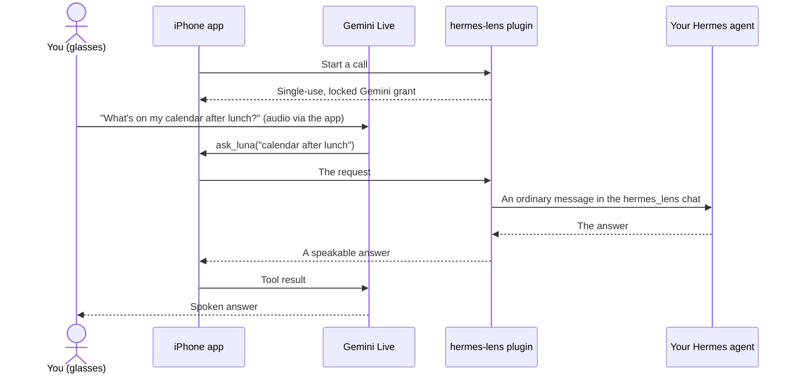

<p align="center"></p>

<h1 align="center">Hermes Lens</h1>

<p align="center"><b>Your own Hermes agent on Ray-Ban Meta glasses.</b><br>
It sees what you see, hears you, and acts, but only when you tap Approve.</p>

<p align="center">
  <a href="https://github.com/brukchip/hermes-lens/actions/workflows/ci.yml"></a>
  <a href="https://github.com/brukchip/hermes-lens/releases"></a>
  <a href="https://hermes-agent.nousresearch.com"></a>
  <a href="LICENSE"></a>
</p>

<p align="center"><a href="#install">Install</a> · <a href="#how-it-works">How it works</a> · <a href="#safety-model">Safety model</a> · <a href="ios/README.md">iPhone app</a></p>

> **Status: 0.2.0, tested on real glasses.** Used on Ray-Ban Meta glasses with an iPhone 13:
> photo looks, business card to contact, questions answered by the Hermes agent, interrupting
> mid-answer and ending calls. The approval card was tested end to end against a live gateway.
> 50 plugin tests and 34 app-core tests run in CI on Hermes 0.22.5 and 0.23.1.

Your Hermes agent knows your notes, calendar, servers and skills, but it lives behind a
keyboard. The assistant built into Ray-Ban Meta glasses is always with you, but it doesn't
know you and can't act for you. Hermes Lens connects the two: put the glasses on and talk to
*your own* Hermes agent, hands-free.

## What you can say

- **"What am I looking at?"** One deliberate photo from the glasses camera, described aloud.
- **"Save this contact."** It reads a business card and opens a prefilled contact on your phone.
- **"What's on my calendar after lunch?"** Your agent answers from your own data, in your ear.
- **"Send me today's summary on Telegram."** Hermes runs it in the background and reports back.

Anything Hermes gates waits for your tap on an **Approve / Decline** card that shows the action
itself. A spoken "yes" never counts.

## Install

You need:

- Hermes Agent **0.22.5 or newer**, running the messaging gateway.
- A **Gemini API key** with Live API access ([Google AI Studio](https://aistudio.google.com/apikey)).
- **Ray-Ban Meta glasses**, the Meta AI app in Developer Mode, and an iPhone with the app built
  from [`ios/`](ios/README.md) in Xcode. Meta does not yet allow apps built on its glasses
  toolkit in the App Store. On the phone the app is called **Luna**.
- A way for the phone to reach the gateway over **HTTPS**, for example
  [`tailscale serve`](https://tailscale.com/kb/1312/serve) in front of `127.0.0.1:8795`.

```bash
hermes plugins install brukchip/hermes-lens --enable --yes-deps   # or `hermes-lens` once it is in the catalog
hermes config set HERMES_LENS_TOKEN "$(openssl rand -hex 32)"
hermes config set GEMINI_API_KEY "<your Gemini key>"
hermes gateway restart
tailscale serve --bg --https=8443 http://127.0.0.1:8795
```

In the app, enter the server address (for example `https://<machine>.<tailnet>.ts.net:8443`)
and the same token, connect the glasses with **Set up with Meta AI**, then tap **Talk to Luna**.

## How it works

Hermes Lens is a **Hermes platform plugin** (this folder) plus an **iPhone app** ([`ios/`](ios/README.md)).



- **Gemini Live is the voice.** It handles conversation, real-time facts (with Google Search) and
  the camera, at conversational speed, and you can interrupt it. Call audio goes straight between
  the phone and Google; it never passes through the plugin or Hermes.
- **Hermes is the brain.** Anything that needs *your* data or an action becomes an ordinary
  message in the `hermes_lens` chat, so your agent answers with the same memory, tools, skills,
  cron jobs and approval rules it has everywhere else. The answer is read aloud.
- **The camera stays on the phone.** `look`, `record_video` and `save_contact` run in the app.
  The camera takes one frame only when asked, never a stream, and photos and clips stay on the
  phone. A business card becomes a prefilled contact that you confirm in Apple's own sheet.

## Safety model

- **Only a tap approves.** When Hermes wants to do something gated (a risky command, or starting
  or changing a background job from the glasses), the phone shows an **Approve / Decline** card.
  You tap it, or give the glasses touchpad a deliberate double tap once the card has been on
  screen for 1.5 seconds. A spoken "yes" never counts, and a call never grants a standing approval.
- **The card shows the action itself.** For a background job: when it runs, where its result goes,
  the whole instruction and every other argument. Text past 2,000 characters is marked as cut,
  with the number of characters not shown.
- **Silence is a no.** Unanswered cards are denied after two minutes, and hanging up denies them at
  once. With no live call to show a card on, the plugin denies.
- **The tap rule.** A `pre_tool_call` hook holds background jobs started from the glasses for your
  tap, even where Hermes would not ask. It uses Hermes's own approval gate, so if you run Hermes
  with approvals switched off (yolo mode, or `approvals.mode: off`), Hermes approves by itself and
  no card appears.
- **Locked voice grants.** Each call gets a single-use Gemini token (9 minutes or less) whose model,
  voice, persona and tools are fixed on the server. The phone cannot widen them, and your Gemini
  key never leaves the server.

## Plugin endpoints

| Endpoint | Purpose |
|---|---|
| `POST /v1/lens/realtime/calls` | Mints a **single-use, locked** Gemini Live token for one call (≤ 9 minutes). Model, voice, persona and tools are fixed server-side; the phone cannot widen them. |
| `DELETE /v1/lens/realtime/calls/{id}` | Ends the call and settles its usage. |
| `POST /v1/lens/native/tools` | The voice model's `ask_luna(request)` becomes a message to your agent; the reply comes back speakable. |
| `POST /v1/lens/native/approvals` | Your Approve / Decline tap on a Hermes approval card. |
| `GET /v1/lens/config`, `GET /health` | What the app needs to switch on native voice. |

Every request carries a bearer token (`HERMES_LENS_TOKEN`) and a per-install device id. One
live call per phone, 30 requests a minute per device (120 in total), and a daily cap on call
minutes. A retried request never runs twice.

## Settings

| Variable | Default | Meaning |
|---|---|---|
| `HERMES_LENS_TOKEN` | required | Shared secret the app sends (24+ random characters). |
| `GEMINI_API_KEY` | required | Used only to mint short-lived call tokens. |
| `HERMES_LENS_HOST` / `HERMES_LENS_PORT` | `127.0.0.1` / `8795` | Where the plugin listens. Keep it on loopback behind a TLS proxy. |
| `HERMES_LENS_ASSISTANT_NAME` | `Luna` | What the voice companion calls itself. |
| `HERMES_LENS_USER_NAME` | empty | Your name, so it can address you. |
| `HERMES_LENS_PERSONA_NOTES` | empty | Extra guidance, e.g. "Keep answers short; I'm often somewhere noisy". |
| `HERMES_LENS_VOICE` | `Kore` | Gemini prebuilt voice. |
| `HERMES_LENS_MODEL` | `gemini-3.8-live` | Gemini Live model. |
| `HERMES_LENS_CONFIRM_TOOLS` | `cronjob_manage,cronjob,send_message` | Tools that need your tap when asked for through the glasses, on top of Hermes's own approval rules. Names are matched exactly, and `send_message` only applies on Hermes versions where the agent can call a tool of that name; a message sent some other way (a shell command, an MCP tool) falls under Hermes's own rules. Listing jobs never asks. `none` turns it off. |
| `HERMES_LENS_DAILY_MINUTES` | `60` | Daily cap on call minutes (each call reserves up to 9, so set at least 10). It limits spend from your own phone; it is not a defence against someone who holds the token. |

Long jobs work like every other Hermes channel: ask for a report and your agent can run it as a
one-time background job delivered to your home channel (Telegram, for example) instead of
keeping you on the call.

## Disclosure

- **Network calls:** the plugin calls `generativelanguage.googleapis.com` (`/v1beta/auth_tokens`)
  with your `GEMINI_API_KEY`, once per call, to mint a single-use token. Call audio goes directly
  between the phone and Google; it never passes through the plugin or Hermes.
- **Background server:** while the gateway runs, the plugin listens on `HERMES_LENS_HOST:PORT`
  (loopback by default) and runs a small task that denies unanswered approval cards.
- **Stored data:** the plugin stores only call-time records (start time and seconds used, kept
  40 days) in `usage.sqlite3` in its data directory, to enforce the daily cap. It stores and
  logs no audio, transcripts, requests, answers or tokens. Your requests and Hermes's answers
  are ordinary messages in the `hermes_lens` chat, so Hermes keeps them in its session history
  and memory exactly as it does for any other channel.
- **Hook:** a `pre_tool_call` hook sends the tools in `HERMES_LENS_CONFIRM_TOOLS` to Hermes's
  own approval gate, but only when the request came through the glasses. Other channels are
  untouched, and a decline or timeout blocks the tool. With Hermes approvals switched off, the
  gate approves by itself and the rule has no effect.
- **Approvals:** the plugin never approves anything itself. It resolves a Hermes approval only
  from your tap on that call, with `once` or `deny`, and only the exact approval shown on the
  card. With no live call to show a card on, it denies. Rotating `HERMES_LENS_TOKEN` locks out
  every phone at once.
- **Authentication:** the phone authenticates with the bearer token. Because of that, the plugin
  marks its sessions as adapter-authorized, so no pairing code is needed. Anyone holding the
  token can talk to your agent, so keep it secret and the port off the public internet.

## Development

```bash
pip install pytest
PYTHONPATH=/path/to/hermes-agent pytest tests     # adapter tests need Hermes importable
hermes plugins validate . --install-deps
hermes plugins doctor . --ci
```

MIT licensed. Not affiliated with Meta or Google. Ray-Ban and Meta are trademarks of their owners.
